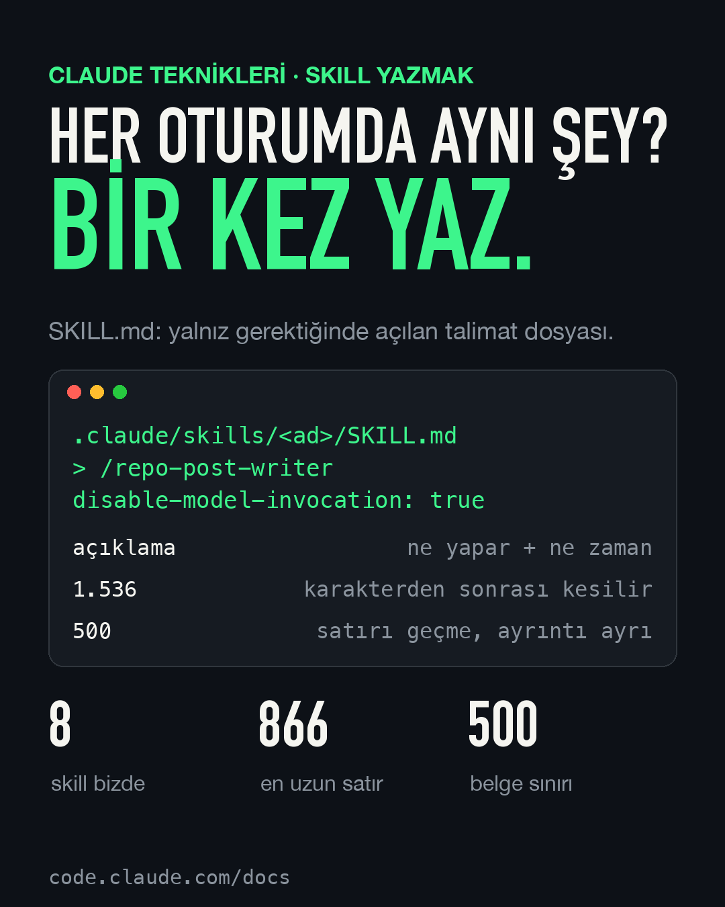

# Claude'a aynı 10 adımı her gün yeniden mi anlatıyorsun? 📄

Skill, depodaki .claude/skills/<ad>/SKILL.md dosyası; Claude tam metni yalnız gerektiğinde okur.

**✨ Öne çıkanlar:**
• açıklama: ne yapar + ne zaman, 1.536 karakter sınırı
• SKILL.md 500 satırın altında, ayrıntı ayrı dosyada
• yan etkili işe disable-model-invocation: true

**📊 Rakamlarla:**
• 8 skill bizde
• 866 en uzun satır
• 500 belge sınırı

**📌 Kısa notlar:**
• açıklama: ne yapar + ne zaman
• 1.536: karakterden sonrası kesilir
• 500: satırı geçme, ayrıntı ayrı

**⚙️ Nasıl başlarsın:**
.claude/skills/<ad>/SKILL.md
> /repo-post-writer
disable-model-invocation: true

[▶ Tam kalite video: video.mp4](video.mp4)

## Videoda adım adım

1. Adı skill, depodaki bir klasörde ekibin de kullandığı tek bir talimat dosyası.
2. Başta üç tire arasına ne yaptığını ve ne zaman kullanılacağını, altına da adımları yazıyorsun.
3. Claude her oturumda yalnız açıklamaları görüyor, tam metni ancak iş o konuya gelince okuyor.
4. Artık her oturumda anlatmıyorsun, / ve skill adını yazınca bütün adımlar hazır geliyor.
5. Açıklamada asıl kullanım başta olmalı, 1.536 karakterden sonrası listede kesiliyor.
6. Dosya 500 satırı geçmesin, uzun ayrıntıyı yanındaki ayrı bir dosyaya taşıyorsun.
7. Yayın gibi yan etkili işleri Claude kendi başına başlatmasın diye tek satırlık ayar ekliyorsun.
8. Bu projede 8 skill var ve en uzunu 866 satır, yani bölünmeyi bekliyor.
9. Bunu bu bilgisayarda kullanıyoruz ama kesin kural için skill yetmiyor, belge hook öneriyor.

## Lisans

Bu depodaki video, kart ve metinler MIT lisanslıdır (LICENSE). Anlatılan aracın kendi lisansı kendi deposundadır.
